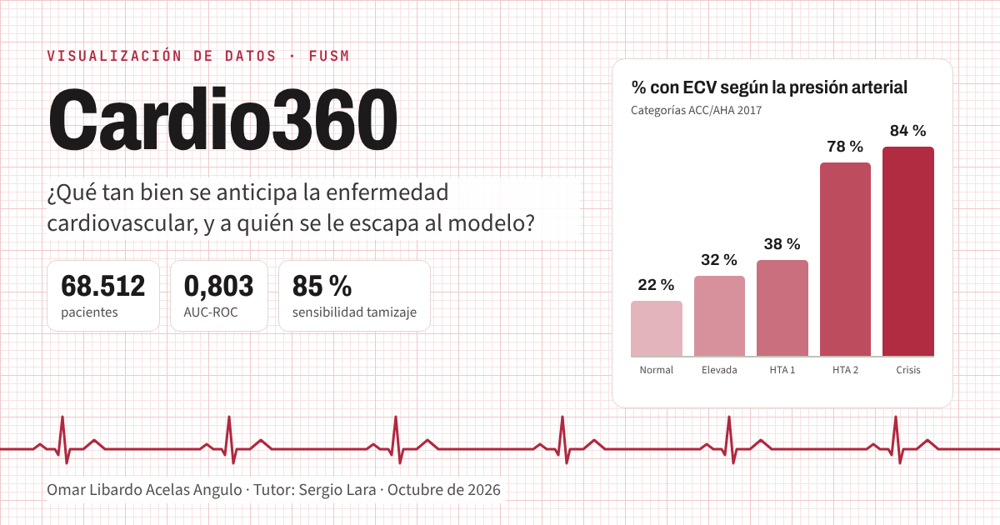

# Cardio360 · Predicción de riesgo cardiovascular

**Proyecto final de Visualización de Datos · Fundación Universitaria San Mateo (FUSM), Bogotá**
Autor: **Omar Libardo Acelas Angulo** · Tutor: **Sergio Lara** · Octubre de 2026

🔗 **Sitio del proyecto:** https://omarli-360.github.io/cardio360/
📊 **Tablero interactivo:** https://omarli-360.github.io/cardio360/tablero/



Con 14 variables de un examen médico de rutina, la enfermedad cardiovascular (ECV) se anticipa con un **AUC-ROC de 0,803** (XGBoost, 13.703 pacientes de prueba). El techo lo ponen las variables disponibles, no el algoritmo ni la cantidad de datos. Con un umbral único, el modelo es equitativo por sexo pero no por edad.

## Cuadernos

| Cuaderno | Contenido | Abrir |
|---|---|---|
| `01_EDA_y_Limpieza` | Perfil de los datos, 7 reglas de limpieza clínica, variables derivadas, prevalencias, correlaciones y CSV depurado | [](https://colab.research.google.com/github/OmarLi-360/cardio360/blob/main/cuadernos/01_EDA_y_Limpieza.ipynb) |
| `02_Modelado_y_Evaluacion` | Regresión logística, Random Forest y XGBoost; curvas de validación y de aprendizaje; ROC, calibración, umbral clínico, SHAP, equidad y ficha del modelo | [](https://colab.research.google.com/github/OmarLi-360/cardio360/blob/main/cuadernos/02_Modelado_y_Evaluacion.ipynb) |
| `03_Reduccion_Dimensionalidad` | PCA, t-SNE y UMAP; sensibilidad a hiperparámetros; confiabilidad y AUC de k-NN; SHAP por paciente | [](https://colab.research.google.com/github/OmarLi-360/cardio360/blob/main/cuadernos/03_Reduccion_Dimensionalidad.ipynb) |

En Colab: **Entorno de ejecución → Ejecutar todas**. Los cuadernos leen los datos de este repositorio.

## Estructura

```
cardio360/
├── index.html                  portada del sitio (GitHub Pages)
├── tablero/                    tablero: index.html (web) y tablero_riesgo_cardiovascular.html (sin internet)
├── cuadernos/                  los tres cuadernos, ya ejecutados
├── datos/                      cardio_train.csv (original) y cardio_depurado.csv (limpio)
├── resultados/                 eda.json, modelos.json, latente.json (salidas de los cuadernos)
├── informe/                    informe ejecutivo (PDF y Word)
├── recursos/                   plantilla del tablero y librería Plotly
├── assets/                     ícono e imagen para compartir
├── construir_tablero.py        regenera el tablero a partir de resultados/
├── requirements.txt            dependencias (Python 3.10 a 3.12)
└── GUIA_Cardio360.pdf          guía paso a paso
```

## Repetirlo en el computador (Windows)

```bat
cd C:\Cardio360
py -3.12 -m venv .venv
.venv\Scripts\activate
pip install -r requirements.txt
jupyter lab
:: ejecutar los cuadernos 01, 02 y 03 en orden; luego:
py construir_tablero.py
```

Detalles, valores esperados y solución de problemas: [`GUIA_Cardio360.pdf`](GUIA_Cardio360.pdf).

## Datos

Ulianova, S. (s. f.). *Cardiovascular Disease dataset* [Conjunto de datos]. Kaggle. https://www.kaggle.com/datasets/sulianova/cardiovascular-disease-dataset

`datos/cardio_depurado.csv` usa separador `;` y decimales con coma. En Python: `pd.read_csv("datos/cardio_depurado.csv", sep=";", decimal=",")`.

## Uso responsable

Herramienta educativa. No diagnostica ni reemplaza el criterio de un profesional de la salud.

## Uso de inteligencia artificial

El proyecto se desarrolló con apoyo de Claude (Anthropic, 2026), un modelo de lenguaje grande, para localizar y verificar los datos, escribir el código, redactar el informe y comprobar la cibergrafía. El autor definió el alcance, validó las decisiones del análisis y es responsable del contenido. La cibergrafía completa está en el sitio y en la guía.
